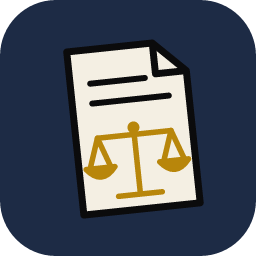

  

# LawCraft

LawCraft is a word processor for lawyers. It is [WordCraft](https://github.com/storytold/wordcraft), the open-source Word replacement, with legal tools built in and turned on.

It opens and saves Word files, so the people you send filings to never know the difference. What it adds is the part Word leaves to you:

- **Court profiles.** Margins, type size, line spacing, captions, page numbering and word limits for a court, saved as a profile and applied to a document in one step. Missouri circuit and federal profiles ship with it; you can make your own and share them as a file.
- **Filing checks.** Before you export, LawCraft checks the document against the court's profile and tells you what is out of rule.
- **Citations.** Form checks for case and statute citations as you type, and a table of authorities built from the citations it finds.
- **Pleadings.** New Pleading builds a motion or petition with the caption, signature block and certificate of service already in place.
- **Legal proofing.** A legal word list and checks for the confusions spell check misses (statute and statue, counsel and council).
- **Certificates of compliance** with the word count kept current.

LawCraft runs on Windows, macOS and Linux, and checks for its own updates.

## Download

Installers are on the [releases page](https://github.com/CharitonMedia/lawcraft/releases).

## How it relates to WordCraft

LawCraft tracks WordCraft closely. Every night it merges WordCraft's latest work, runs the full test suite, and publishes the result. The legal tools are offered back to WordCraft as pull requests ([#1493](https://github.com/storytold/wordcraft/pull/1493), [#1863](https://github.com/storytold/wordcraft/pull/1863)); if WordCraft takes them, LawCraft will follow.

LawCraft keeps its own settings folder and its own app id, so it installs beside WordCraft without touching it.

Building from source, the architecture and the contributor guide are WordCraft's: see [AGENTS.md](AGENTS.md) and [docs/](docs/). The legal module is documented in [docs/law.md](docs/law.md).

## License

LawCraft, like WordCraft, is dual-licensed under the [MIT License](LICENSE-MIT) or the [Apache License 2.0](LICENSE-APACHE), at your option. WordCraft's notices are kept in [NOTICE](NOTICE) and [ATTRIBUTION.md](ATTRIBUTION.md).

LawCraft is published by Chariton Media. It is an independent edition and is not made or endorsed by the WordCraft or ArtCraft projects.
